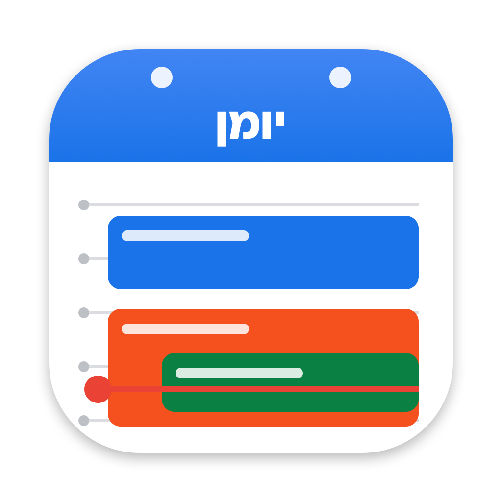

<p align="center">
  
</p>

<h1 align="center">Yoman</h1>

<p align="center">A menu-bar calendar for macOS with a Google-Calendar-style interface.<br>
<i>Yoman</i> (יומן) is Hebrew for "diary / calendar".</p>

---

Click the date in your menu bar to get a month at a glance plus your day, week or month,
styled like Google Calendar. Inspired by [Itsycal](https://www.mowglii.com/itsycal/), rebuilt
in SwiftUI with more views and multi-account support. Not affiliated with Google or Mowglii.

## Features

- **Menu-bar popup** – mini month with colored event dots and a highlighted weekend, plus a
  lower pane you can switch between **List**, **Day**, **Week** and **Month**.
- **Google-Calendar look** – time grid with a red "now" line, overlapping events laid out
  side by side or cascaded, all-day lane, outlined/striped/struck-through blocks for
  unanswered, "maybe" and declined invites, readable text on light colors.
- **Full calendar window** (⤢) – Day / Week / Month / Schedule with a sidebar, search and
  per-account calendar toggles.
- **Meetings** – detects Zoom, Google Meet, Teams, Webex, FaceTime and Chime links: one-click
  **Join**, plus a "Standup in 5m" countdown in the menu bar.
- **Create, edit, duplicate, delete** events (repeat, alert, location, notes, Google Meet).
- **Multiple calendars and accounts** – everything macOS syncs (iCloud, Google, Exchange…)
  and, optionally, Google accounts signed in directly via the Google Calendar API
  (adds RSVP, Google event colors, Meet creation).
- **Keyboard** – ⌥⌘K opens it anywhere; `d` `w` `m` `l` switch views, `t` today, `n` new
  event, arrows move the selection.
- Configurable popup size, hour height, mini-month size, week start, week numbers, weekend
  highlight, menu-bar style and more. Handles daylight-saving days and right-to-left text.

## Requirements

- macOS 14 (Sonoma) or later
- To build: Apple's Command Line Tools (`xcode-select --install`) or Xcode

## Install

```bash
git clone https://github.com/nivohavi/yoman.git
cd yoman
./build.sh install     # builds a universal app and copies it to /Applications
```

On first launch macOS asks for calendar access — choose **Allow Full Access**.
Rebuild and restart after pulling changes with `./build.sh`.

> An app you build yourself isn't quarantined, so Gatekeeper won't block it. A copy downloaded
> from elsewhere would need to be signed with a Developer ID and notarized.

## Google sign-in (optional)

Yoman works out of the box with accounts added in **System Settings › Internet Accounts**.
For RSVP, Google event colors and Meet links, connect Google directly:

1. In [Google Cloud Console](https://console.cloud.google.com/apis/credentials) create a project
   and enable the **Google Calendar API**.
2. Configure the OAuth consent screen (Internal for Workspace, or External + add yourself as a
   test user) with the `…/auth/calendar` scope.
3. Create an **OAuth client ID** of type **Desktop app**.
4. In Yoman: **Settings › Google**, paste the client ID and secret, then **Sign in with Google**.

Sign-in uses the browser with PKCE and a loopback redirect; tokens are stored in your Keychain.
Turn off **Use Apple Calendar** if the same account is also synced by macOS, to avoid duplicates.

## Privacy

Yoman has no server and no analytics. Calendar data is read on your Mac through Apple's
EventKit; when Google sign-in is used, it talks only to Google's Calendar API.

## Project layout

| Path | What |
|---|---|
| `Sources/Yoman/YomanApp.swift` | App entry, menu-bar item, popover, windows, global hot key |
| `Sources/Yoman/CalendarModel.swift` | Merges EventKit and Google calendars; fetching and editing |
| `Sources/Yoman/GoogleAuth.swift`, `GoogleStore.swift` | OAuth (PKCE + loopback) and Calendar API client |
| `Sources/Yoman/CompactView.swift`, `PopupTimeline.swift` | The menu-bar popup |
| `Sources/Yoman/RootView.swift`, `TimeGridView.swift`, `MonthAndScheduleViews.swift` | Full calendar views |
| `scripts/make-icon.swift` | Renders `Resources/AppIcon.icns` |
| `build.sh` | Builds, signs (ad-hoc), installs and restarts the app |

Developer flags (for testing): `--popup`, `--window`, `--mode=week`, `--date=YYYY-MM-DD`,
`--no-focus`, `--dump-sources`, `--selftest`.

## License

[MIT](LICENSE)
